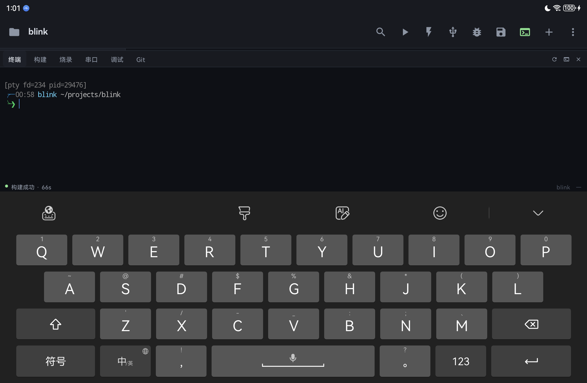
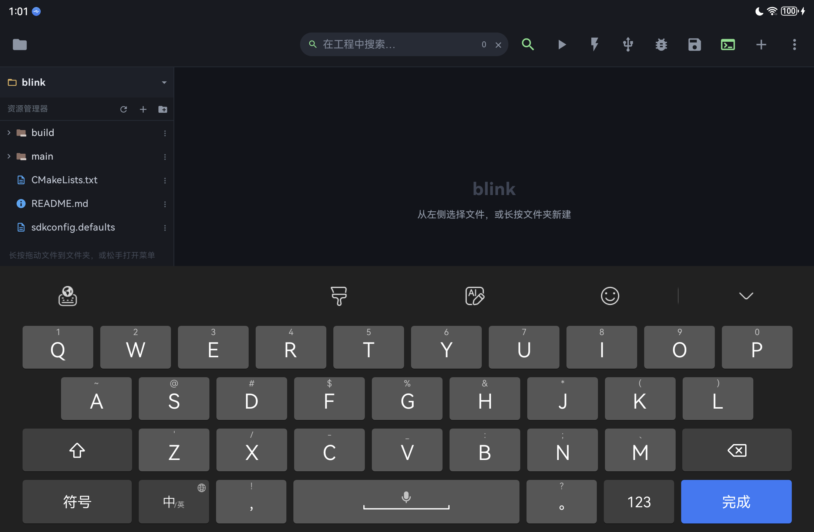

# EspForge — Android 平板上的 ESP32 IDE

> 官方 ESP-IDF 工程结构 + **平板本地编译** + USB 烧录 + 串口调试。
> 从 CodePad 派生；本文件同时是**交接文档**（换新会话时先读这里）。

- 工程目录：`D:\DSH\espstudio`
- 包名：`com.espforge.ide`　应用名：`EspForge`　版本：`0.1`
- 设备：HUAWEI BTK-W00（MatePad），Android 12，arm64-v8a，adb 序列号 `7VXYD24309200097`
- 最近更新：2026-11-26（**App 内完整构建跑通**、终端修好、键盘不再挡终端）

---

## 一、现在能用的 / 不能用的

| 功能 | 状态 | 说明 |
|---|---|---|
| 编辑器 / 资源管理器 / Git / 搜索 | ✅ 可用 | Monaco，顶栏搜索框 + 浮层结果 |
| 工程生成 | ✅ 可用 | 官方 IDF 结构（`CMakeLists.txt` + `main/` + `sdkconfig.defaults`） |
| 资源包导入 + 自动修补 + `.ok` 标记 | ✅ 可用 | 修补全部写进 `Toolchain`，见第四节 |
| **App 内「▶ 构建」** | ✅ **可用** | 真机从零完整构建 **66 秒 / 930 个目标**，见第六节 |
| 终端面板 | ✅ 可用 | 真 PTY，有提示符，见第五节 |
| 虚拟键盘 | ✅ 修好 | 终端里键盘不再挡住终端；编辑/搜索仍然不挤压编辑区 |
| 烧录 / 串口 | ⚠️ 代码已写，未真机验证 | `serial/EspFlasher.kt` 自己实现 esptool ROM 协议 |

### 已验证（真机，删掉 `build/` 和 `sdkconfig` 后从零开始）

```
App 内点 ▶：  [930/930] 构建成功 · 66s
              build/blink.bin   207,456 字节
              build/blink.elf 2,835,516 字节
CLI（run-as）：同一套资源包 + Toolchain.env() 也通过（用于对照排查）
```


---

## 二、工具链与构建环境

构建用的工具链不在仓库里，用 dsh-androidforge 插件自带的那套：

```powershell
$tc = 'D:\DSH\plugins\dsh-androidforge\toolchain'   # jdk17 / android-sdk / gradle-8.10.2
$env:JAVA_HOME="$tc\jdk17"; $env:ANDROID_HOME="$tc\android-sdk"; $env:ANDROID_SDK_ROOT=$env:ANDROID_HOME
$env:GRADLE_USER_HOME="$tc\gradle-home"; $env:ANDROID_USER_HOME="$tc\android-user"
$env:TEMP="$tc\tmp"; $env:TMP=$env:TEMP          # 必须，否则 gradle/adb 起不来
& "$tc\gradle-8.10.2\bin\gradle.bat" -p D:\DSH\espstudio assembleDebug --no-daemon --console=plain
```

产物：`app/build/outputs/apk/debug/app-debug.apk`（约 27 MB），另存 `dist\EspForge-0.1-arm64.apk`。

**adb 的坑**：adb 默认往 `%TEMP%\adb.log` 写日志，那个文件被沙箱 ACL 锁住会 `Permission denied`，
daemon 起不来。每次用 adb 前设 `$env:TEMP='D:\DSH\espstudio\.adbtmp'`。

### 原生库必须由仓库里的源码编译

| 产物 | 源码 | 编译命令（NDK r27c） |
|---|---|---|
| `app/src/main/assets/execshim` | `native/execshim.c` | `aarch64-linux-android26-clang -O2 -fPIE -pie -o ...` |
| `app/src/main/jniLibs/arm64-v8a/libptybridge.so` | `native/ptybridge.c` | `aarch64-linux-android26-clang -O2 -shared -fPIC -o ...` |
| 诊断用（不入 APK） | `native/scprobe.c`、`native/sigsysprobe.c` | 见第六节 |

```powershell
$bin='D:\DSH\toolchain\ndk\android-ndk-r27c\toolchains\llvm\prebuilt\windows-x86_64\bin'
$env:TEMP='D:\DSH\espstudio\.ntmp'               # 同理，默认 TEMP 会被 ACL 挡住
& "$bin\aarch64-linux-android26-clang.cmd" -O2 -fPIE -pie `
    -o app\src\main\assets\execshim native\execshim.c
```

**坑**：`libptybridge.so` 以前是从 CodePad 继承的，导出 `Java_com_codepad_ide_term_Pty_*`；
包名改成 `com.espforge.ide` 后 JNI 符号找不到，`Pty.start()` 静默失败、终端全黑。
改包名一定要同步重编原生库，并用 `llvm-nm -D` 确认符号名。

---

## 三、资源包（不进 APK）

`pack\esp-idf-5.2.5-arm64.zip`　**343.9 MiB**　sha256 `66a39432767dbc7131c81194d4f6871960dae392fef00f2166613398168a4f13`

```
esp-idf/                  ESP-IDF v5.2.5（裁掉 .git/docs/examples）
tools/xtensa-esp32-elf/   官方 per-chip 交叉工具链 12.2.0（原始二进制，未改）
tools/xtensa-esp32s3-elf/
tools/cmake/              bionic cmake 4.5 + ninja 1.13 + make，含 api-level.h
tools/python/             bionic python 3.14.10（Termux 构建）
tools/python-site/        esptool 4.14 / kconfiglib / pyyaml / pyelftools …
glibc/                    aarch64 glibc 运行时（Debian bookworm）
manifest.json
```

设备上的位置：`/data/user/0/com.espforge.ide/files/pack`（tar 侧载的 1.2 GB 解压版）。
重建脚本在 `pack/scripts/`：`build-pack-525.py`（可续跑）、`verify-pack-525.py`、`make-docs-525.py`。

### 关键设计：glibc 工具链怎么在 bionic 上跑

工具链是 glibc 二进制，Android 是 bionic，直接 exec 会找不到 `/lib/ld-linux-aarch64.so.1`。

- **不要**对工具链二进制做 `patchelf`（会破坏 ELF 段布局，`cc1` 段错误）
- 做法：`native/execshim.c` → 原生 ELF 垫片，从 `/proc/self/exe` 向上找
  `glibc/lib/ld-linux-aarch64.so.1` 定位 pack 根，然后
  `execv(loader, [--library-path <glibc/lib> <自身>.real 原参数])`
- `Toolchain.wrapGlibc()` 把每个 ELF 可执行文件改名 `*.real`，原位置放垫片
- **必须用 ELF 垫片，不能用 shell 脚本**：ninja 用 `posix_spawn` 直接 exec，脚本形式 127

---

## 四、资源包修补（全部已落地到代码）

`Toolchain.applyPackPatches()` / `finalizePack()` 幂等执行；`PACK_VERSION` 变了老标记自动失效。
`.ok-<PACK_VERSION>`（现在是 `.ok-4`）是「资源包已就绪」的唯一标记。

| # | 修补 | 实现 | 为什么 |
|---|---|---|---|
| 1 | `tools/cmake/bin/{ninja,cmake,make}` 里的 Termux shell 路径 → `/system/bin/sh`（**等长字节替换**，多余补 NUL） | `patchTermuxShell()` | Termux 版 ninja 把 shell 硬编码成 Termux 路径，每条命令 `code=127` |
| 2 | `serial/tools/list_ports_posix.py` 给 Android 加分支返回 `[]` | `patchPyserial()` | 平台未知时 pyserial 直接 `raise ImportError`，esptool 一 import 就炸 |
| 3 | `site-packages/espforge_pack.pth` 写入 `$P/tools/python-site` | `patchPythonPath()` | `idf.py` 给子进程的环境会丢 `PYTHONPATH` |
| 4 | `esp-idf/tools/cmake/gdbinit.cmake` 在 `ESP_ROM_ELF_DIR` 为空时 `return()` | `patchGdbinit()` | 包里没有 rom-elfs，`file(TO_CMAKE_PATH)` 参数不足会中断 configure |
| 5 | 工程模板 `sdkconfig.defaults` 加 `CONFIG_MBEDTLS_CERTIFICATE_BUNDLE=n` | `fs/Templates.kt` | 证书包生成要 Termux 的 `cryptography`/`_cffi_backend`，包里没有 |
| 6 | `env()` 不设 `IDF_PYTHON_ENV_PATH` | `Toolchain.env()` | 设了 IDF 会按 venv 校验依赖，走进 "venv doesn't exist" |
| 7 | glibc 的 `set_robust_list(#99)` / `rseq(#293)` 调用点 `svc #0` → `nop`；`faccessat2(#439)` → `faccessat(#48)` | `patchGlibcSyscalls()` | app seccomp 会杀这些 syscall，见第六节 |
| 8 | 垫片清掉 `GCC_EXEC_PREFIX`/`COLLECT_GCC*`，并把已包装的工具换成新垫片 | `native/execshim.c` + `refreshWrappedShims()` | 带着 `GCC_EXEC_PREFIX` 时 `cc1` 会 SIGSYS |

顺带修的：

- **`.ok` 标记**：以前只在「这次真的包了文件」时写，tar 侧载的包永远拿不到 → App 一直说「没装资源包」。
  现在统一由 `markReadyIfComplete()` 落标记，`pruneOldMarkers()` 清掉旧版本标记。
- **`refreshPack()` 里的路径写错**：原来检查 `xtensa-esp-elf-gcc`（不存在，实际 `xtensa-esp32-elf-gcc`），
  自动整理从来没触发过。现在走 `finalizePack()`，构建前也会兜一次。

---

## 五、终端与虚拟键盘（都已修）

### 终端为什么以前是黑屏

1. **WebView 调用跑到 JavaBridge 线程**：`onTerminalReady()` 由 JS 桥在子线程回调，里面直接调
   `applyTerminalSettings()` → `evaluateJavascript` 抛 "WebView method called on wrong thread"，
   整段中断，`ui { ensureTerminal() }` 从没执行。现在整个回调体都进 `ui {}`（主线程）。
2. **JNI 符号对不上**：`libptybridge.so` 还是 CodePad 的 `com.codepad.ide` 版本，
   `com.espforge.ide.term.Pty` 找不到实现 → `Pty.start()` 失败且没有任何日志。
   现在 `native/ptybridge.c` 在仓库里，失败会 `Log.e` 并把原因写进终端。

终端启动后会先打一行 `[pty fd=… pid=…]`，方便确认 PTY 真的起来了。

### 键盘：编辑/搜索「盖住」，终端「抬起来」

- 编辑器 / 搜索框获得焦点：保持 `adjustNothing`，键盘直接盖住底部面板，**不挤压编辑区**（原约定不变）。
- 终端/串口面板里的 WebView 获得焦点：把「底部面板 + 状态栏」整体**向上平移键盘高度**
  （`Modifier.offset { IntOffset(0, -dockLift) }`，`dockLift = ime.getBottom()`），只是平移、
  不改布局高度，所以终端完整露在键盘上方。

实现要点：`IdeController.dockImeFocused` 由终端/串口 WebView 的 `setOnFocusChangeListener` 维护，
编辑器拿到焦点时置 false；`Ui.kt` 里据此算 `dockLift`。





---

## 六、⚠️ 关键：怎么让 glibc 程序在 App 进程里跑起来（seccomp）

这是本项目最硬的一块。**Android app 进程的 seccomp 过滤器会 KILL_PROCESS 掉一串 syscall**，
而 glibc 的启动路径正好会用到其中几个 —— 结果是任何 glibc 二进制一 exec 就 `Bad system call`
（SIGSYS，退出码 159），连 `gcc --version` 都过不去。

### 实测的「杀名单」（`native/scprobe.c` 在 App 终端里跑出来的）

```
rseq               signal=31 (SIGSYS)
clone3             signal=31 (SIGSYS)
get_mempolicy      signal=31 (SIGSYS)
mbind              signal=31 (SIGSYS)
set_mempolicy      signal=31 (SIGSYS)
move_pages         signal=31 (SIGSYS)
migrate_pages      signal=31 (SIGSYS)
io_uring_setup     signal=31 (SIGSYS)
pkey_alloc         signal=31 (SIGSYS)
set_robust_list    signal=31 (SIGSYS)
get_robust_list    signal=31 (SIGSYS)
（process_vm_readv/writev、perf_event_open、userfaultfd、membarrier 是放行的）
```

对照：`/proc/<app pid>/status` 里 `Seccomp: 2 / Seccomp_filters: 1`；
`run-as … sh` 的 `Seccomp: 0`。这解释了为什么 CLI（`run-as`）能构建、App 里不能。

### 三处针对性处理（都在 `Toolchain` 里，随资源包就绪自动做）

1. **ld.so 与 libc.so.6 的 `set_robust_list`/`rseq`**
   glibc 每个进程启动都会调。把 `mov x8,#99` / `mov x8,#293` 后面 40 字节内的 `svc #0`
   改成 `nop`（等长替换）。ld.so 有 2 处（`0x1073c`、`0x10790`），libc 有 3 处。
   返回值 glibc 都忽略——代价只是 `PTHREAD_MUTEX_ROBUST` 的 robust 语义没了，工具链不用它。
2. **`faccessat2` → `faccessat`**
   glibc 的 `access()` 优先用 `faccessat2(#439)`，Android 杀它。把 `mov x8,#439` 直接改成
   `mov x8,#48`（老 `faccessat`，`flags=0` 时语义一致）。**ld 就是死在这一步**。
3. **`GCC_EXEC_PREFIX`**
   cc1 的环境里只要带着它就会 SIGSYS（实测：`unset` 后立刻正常）。垫片在 exec 前统一
   `unsetenv` 掉 `GCC_EXEC_PREFIX`/`COLLECT_GCC`/`COLLECT_GCC_OPTIONS`，并刷新已包装的工具。

### 以后再遇到「Bad system call」怎么定位

```powershell
# 1) 谁被杀了：先看是哪个工具
& $adb logcat -d -s EspForge        # 或看构建面板

# 2) 哪个 syscall：把探针塞进 glibc 程序（不走 shim，直接 ld.so + --preload）
$bin='D:\DSH\toolchain\ndk\android-ndk-r27c\toolchains\llvm\prebuilt\windows-x86_64\bin'
& "$bin\aarch64-linux-android26-clang.cmd" -O2 -shared -fPIC -nostdlib `
    -o cache\sigsysprobe.so native\sigsysprobe.c
# 设备上：
#   ld.so --library-path glibc/lib --preload cache/sigsysprobe.so <tool>.real ...
# 输出形如： [SIGSYS] syscall=439 addr=0x...
# 439 = faccessat2（arm64 编号见 include/uapi/asm-generic/unistd.h）

# 3) 全量探测哪些 syscall 被禁：把 native/scprobe.c 编成 aarch64 二进制，
#    在 App 内置终端里跑（它 fork 子进程逐个试，父进程报信号）
```

**注意**：`SIG_IGN` 没用（内核是 KILL_PROCESS，不是可捕获的 TRAP）；
seccomp 过滤器只能叠加不能放宽，所以只能从「别调那个 syscall」入手。

---

## 七、构建时正确的环境变量

与 `Toolchain.env(chip)` 一致（`run-as` 下照抄就能构建）：

```sh
P=<pack 根>                       # /data/user/0/com.espforge.ide/files/pack
APP=/data/user/0/com.espforge.ide
IDF_PATH=$P/esp-idf
IDF_TOOLS_PATH=$APP/files/idf-tools
PYTHONHOME=$P/tools/python        # Termux 前缀写死，必须覆盖
PYTHONPATH=$P/tools/python-site   # 配合第 3 项 .pth 更稳
PATH=$P/tools/python/bin:$P/tools/xtensa-esp32-elf/bin:$P/tools/cmake/bin:/system/bin
LD_LIBRARY_PATH=$P/tools/python/lib:$P/tools/cmake/lib     # 只给 bionic 程序；glibc 垫片里会 unset
HOME=$APP/files/home
TMPDIR=$APP/cache/tmp
IDF_COMPONENT_MANAGER=0
IDF_PYTHON_CHECK_CONSTRAINTS=no
ESPSTUDIO_SKIP_DEP_CHECK=1        # 对应 idf_tools.py 的补丁
IDF_TARGET=esp32
PREFIX=$P/tools/cmake             # Termux 版 cmake 靠它读 include/android/api-level.h
```

**不要设 `IDF_PYTHON_ENV_PATH`**。

---

## 八、UI 约定（别改坏）

- 键盘：`windowSoftInputMode=adjustNothing`（**代码里 `MainActivity.onCreate` 也有一行，改 manifest 不够**），
  内容列**不要**加 `imePadding()`。例外只有底部面板的「平移」逻辑（见第五节），它不改变布局高度。
- 底部 Dock **永远保持挂载**：不要按 `searchOpen`/键盘把高度收 0、更不要从组合里摘掉，
  否则终端 WebView 反复 attach，点「终端」标签直接崩。
- 终端 WebView 只在「终端」页挂载（其它页挂载会盖住构建/烧录面板，`AndroidView` 是原生层压不住）。
- 顶栏：图标统一灰色剪影，当前激活项变绿。搜索框是顶栏内联的 300dp 圆角长条（靠右贴图标），
  结果用 `Popup` 浮层（左对齐、零动画、14dp 圆角），不要用 `DropdownMenu`（有入场动画会瞬间盖住输入框）。

---

## 九、代码地图

```
app/src/main/java/com/espforge/ide/
├─ IdeController.kt   状态中枢：工程/文件/构建/串口/烧录/调试/Git、终端会话
├─ Ui.kt              Compose 界面（顶栏、资源管理器、编辑器、底部 Dock、键盘平移）
├─ MainActivity.kt    WebView 创建（编辑器/终端/串口）、资源包选择器、软键盘策略
├─ run/
│   ├─ Toolchain.kt   资源包导入/整理/修补、glibc 垫片、IDF 环境变量、进程执行 ★
│   ├─ GdbClient.kt   GDB RSP 客户端（调试用，未接入）
│   └─ DwarfInfo.kt   DWARF 解析（未接入）
├─ serial/
│   ├─ UsbSerial.kt   UsbManager + usb-serial-for-android，DTR/RTS 复位时序
│   └─ EspFlasher.kt  esptool ROM loader 协议（SLIP / FLASH_BEGIN|DATA|END）
├─ fs/{Projects,Templates,Workspace,SearchService}.kt
└─ term/{Pty,TerminalSession}.kt
native/
├─ execshim.c         glibc 入口垫片（定位 pack、清 LD_*/GCC_*、exec ld.so）
├─ ptybridge.c        终端 PTY（forkpty+execve）→ jniLibs
├─ scprobe.c          seccomp 探测：哪些 syscall 被禁
└─ sigsysprobe.c      LD_PRELOAD 探针：抓到 SIGSYS 时打印 syscall 号
pack/scripts/         资源包构建 + 各类补丁脚本（Python 版，App 里已用 Kotlin 重写）
docs/DESIGN.md        设计说明（为什么不用 proot/patchelf/JTAG 等）
```

---

## 十、下一步

1. **烧录**：`build/blink.bin` 已经有了，用 `build/flasher_args.json` + `EspFlasher` 真机烧一次
   （需要把 ESP32 板子插到平板；插上后 adb 得走无线）
2. **串口面板**：`createSerialWebView` 的 AssetLoader 已补（以前会白屏），真机确认能出日志
3. gdbstub 断点调试（复用 `GdbClient` + `DwarfInfo`）
4. 资源包重新打包：把第四节的修补预先打进 zip（App 侧仍会幂等检查，双保险）
5. 换一台 Android 设备复测：确认这份 seccomp 杀名单是华为的策略还是 Android 12 通用

---

## 十一、常用 adb 命令

```powershell
$env:TEMP='D:\DSH\espstudio\.adbtmp'; $env:TMP=$env:TEMP
$adb='D:\DSH\plugins\dsh-androidforge\toolchain\android-sdk\platform-tools\adb.exe'

& $adb devices
& $adb install -r app\build\outputs\apk\debug\app-debug.apk
& $adb shell am force-stop com.espforge.ide
& $adb shell am start -n com.espforge.ide/.MainActivity
& $adb shell "run-as com.espforge.ide sh -c 'ls files/pack'"        # 看 App 私有目录
& $adb logcat -d -s EspForge                                        # 只看自己的日志
& $adb shell screencap -p /sdcard/s.png; & $adb pull /sdcard/s.png $env:TEMP\s.png
& $adb shell input tap <x> <y>                                      # 屏幕实际 2200x1440
& $adb shell input text "ls%s-l"                                    # 空格写 %s
& $adb shell input keyevent 66                                      # 回车
```

坐标（实际 2200×1440；截图预览 1596 宽，比例 1.378）：顶栏搜索图标 `(1428,121)`、
终端图标 `(1973,121)`、Dock 的「终端」「构建」标签 `(62,933)`/`(178,933)`、
构建面板 ▶ `(2068,933)`。

构建期的原始日志在 `<project>/build/log/idf_py_stderr_output_*`，cmake 报错先看它。

---

## 十二、许可证与来源

GPL-3.0（沿用 CodePad）。ESP-IDF、GCC 工具链、CMake、Python 等第三方组件许可见
`THIRD_PARTY_NOTICES.md`。原始 CodePad 项目：https://github.com/Bro588/CodePad-Android
