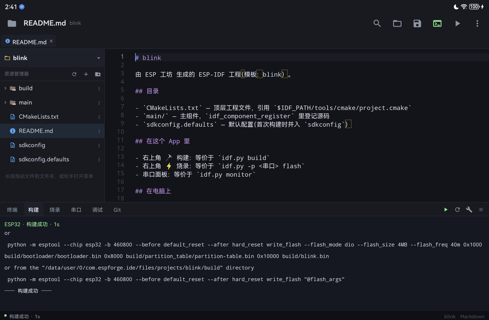
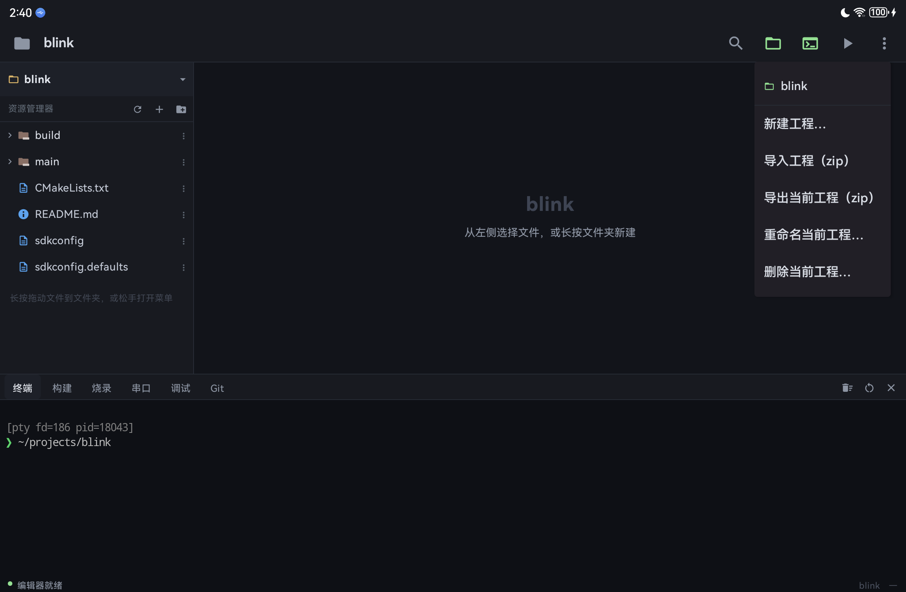
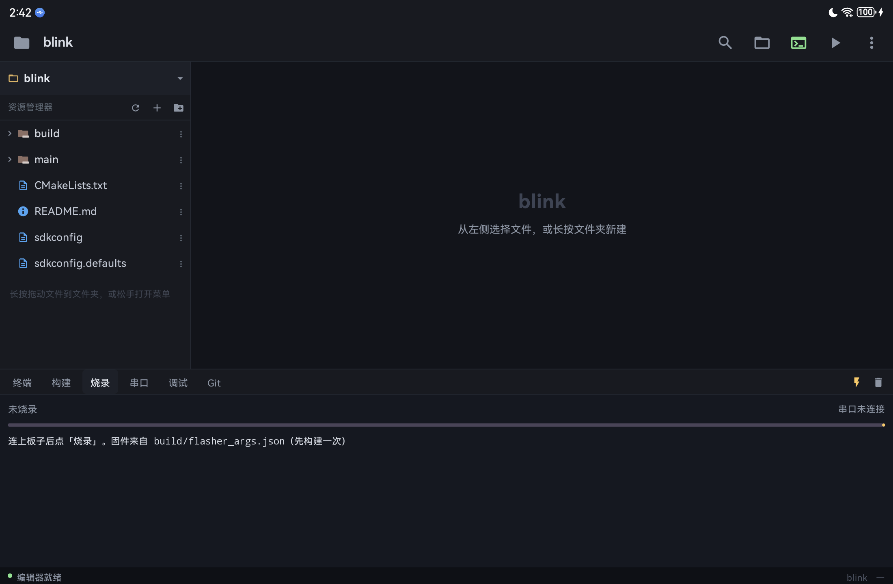
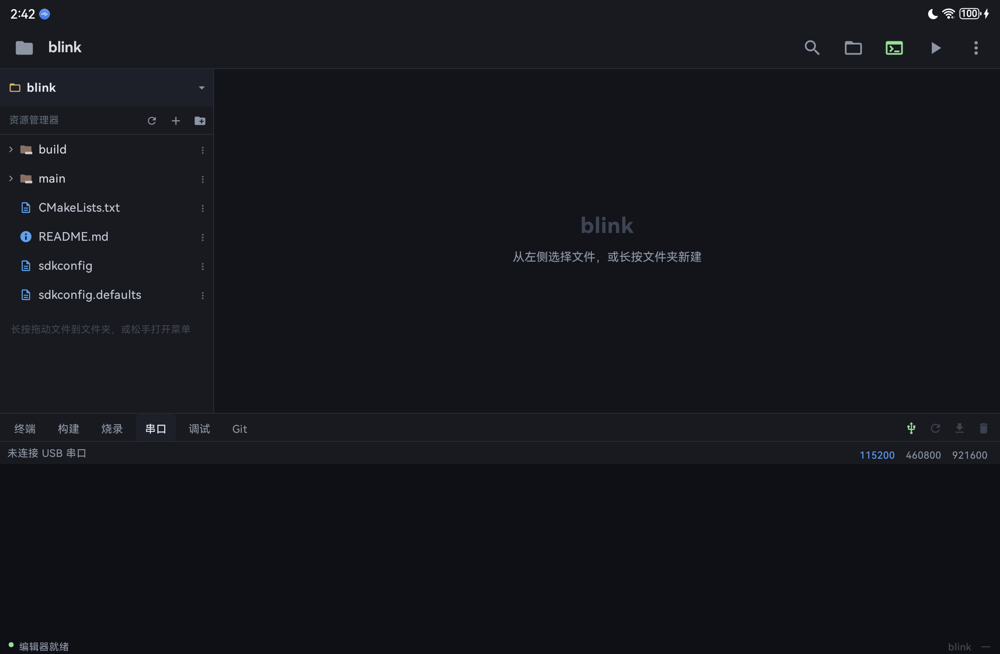

# EspForge

**把 ESP32 开发闭环搬进 Android 平板**：在平板上写代码 → 平板自己跑 `idf.py build` 出固件 → USB 烧进板子 → 串口看日志。

> 开发中（v0.1）· GPL-3.0 · 派生自 [CodePad](https://github.com/Brot588/CodePad-Android)

## 现在的状态

| 能力 | 状态 | 说明 |
|---|---|---|
| 编辑器 / 资源管理器 / 全局搜索 / Git | ✅ | Monaco + xterm.js，完全离线 |
| 官方 ESP-IDF 工程生成 | ✅ | `CMakeLists.txt` + `main/` + `sdkconfig.defaults`，可原样拿到 PC 上编译 |
| **平板本地编译（App 内点 ▶）** | ✅ | 真机从零构建 **66 秒 / 930 个目标**，产出 `blink.bin`（207 KB） |
| 终端 | ✅ | 真 PTY（`forkpty`），vim/top/python 都能跑 |
| 虚拟键盘 | ✅ | 终端里键盘不挡终端；编辑/搜索时不挤压编辑区 |
| USB 烧录 | ⚠️ | `serial/EspFlasher.kt` 自己实现 esptool ROM 协议，**待真机验证** |
| 串口监视 | ⚠️ | UsbManager + usb-serial-for-android，**待真机验证** |
| gdbstub 断点调试 | 🚧 | `run/GdbClient.kt` + `run/DwarfInfo.kt` 已就绪，差接线 |

## 截图

| App 内完整构建 | 终端在键盘上方 |
|---|---|
|  |  |

| 工程菜单 | 烧录面板 |
|---|---|
|  |  |

| 串口面板 | 全局搜索 |
|---|---|
|  |  |

## 为什么这件事不容易

平板上编译 ESP32 固件，难点不在 UI，而在这三件"反常识"的事（细节见 [docs/HANDOFF.md](docs/HANDOFF.md)）：

1. **glibc 工具链跑在 bionic 上**：ESP 的 `xtensa-esp32-elf-*` 是 glibc 二进制，Android 直接 exec 会找不到
   `/lib/ld-linux-aarch64.so.1`。所以仓库里有一个 8 KB 的原生 ELF 垫片（`native/execshim.c`），
   把每个工具改成 `<tool>.real` + 垫片入口，由垫片 `exec` 成
   `ld.so --library-path glibc/lib <tool>.real`。不能用 shell 脚本（ninja 的 `posix_spawn` 会 127），
   也不能 `patchelf`（会破坏段布局，`cc1` 段错误）。
2. **Android 的 app seccomp 会杀 glibc**：过滤器用 `KILL_PROCESS` 处理 `set_robust_list`、`rseq`、
   `faccessat2`、`clone3` 等 syscall，而 glibc 启动路径正好要用其中几个 —— 表现为任何 glibc 程序
   一 exec 就 `Bad system call`（SIGSYS）。项目在资源包就绪时自动做等长指令级修补
   （`svc #0` → `nop`、`faccessat2` → `faccessat`），并在垫片里清掉会触发问题的 `GCC_EXEC_PREFIX`。
3. **离线且没有 venv**：ESP-IDF 默认认为自己在 venv 里、依赖由 `idf_tools.py` 管理。这里把依赖塞进
   `PYTHONPATH` + `.pth`，并用 `ESPSTUDIO_SKIP_DEP_CHECK` 跳过版本校验。

配套的定位工具也在仓库里：`native/scprobe.c`（探测哪些 syscall 被禁）、
`native/sigsysprobe.c`（`LD_PRELOAD` 探针，抓到 SIGSYS 时打印 syscall 号）。

## 构建

需要 JDK 17、Android SDK（compileSdk 35）、NDK r27（只为编两个原生库）。

```bash
# 1) 原生库（否则终端与工具链垫片都没有）
aarch64-linux-android26-clang -O2 -fPIE -pie   -o app/src/main/assets/execshim            native/execshim.c
aarch64-linux-android26-clang -O2 -shared -fPIC -o app/src/main/jniLibs/arm64-v8a/libptybridge.so native/ptybridge.c

# 2) APK
./gradlew assembleDebug      # 产物 app/build/outputs/apk/debug/app-debug.apk
```

`build.ps1` 是 Windows 上的一键脚本（会自动找本机工具链）。

### 资源包（不进仓库）

编译能力依赖一个 **ESP-IDF 5.2.5 + xtensa 交叉工具链 + cmake/ninja + python + glibc** 的资源包
（约 344 MiB 的 zip，解压约 1.2 GiB）。它体积太大，不放在 git 里：

- 生成脚本：`pack/scripts/build-pack-525.py`（可续跑）、`verify-pack-525.py`、`make-docs-525.py`
- App 里通过「导入资源包」选择 zip，或把 zip 放到
  `/sdcard/Android/data/com.espforge.ide/files/pack.zip` 用侧载导入
- 导入后 App 会自动解压、补权限、生成垫片、做上面那些修补，最后落 `.ok-4` 标记

`app/src/main/assets/git.zip`（内置 git）同样不入库。

## 目录结构

```
app/src/main/java/com/espforge/ide/
├─ IdeController.kt   状态中枢：工程/文件/构建/串口/烧录/终端
├─ Ui.kt              Compose 界面（顶栏、资源管理器、编辑器、底部 Dock）
├─ MainActivity.kt    三个 WebView（编辑器/终端/串口）、软键盘策略
├─ run/Toolchain.kt   ★ 资源包导入/修补/垫片/IDF 环境变量
├─ serial/            UsbSerial、EspFlasher（esptool 协议）
├─ fs/                工程、模板、工作区、搜索
└─ term/              Pty（JNI）、TerminalSession
native/               execshim.c、ptybridge.c、scprobe.c、sigsysprobe.c
pack/scripts/         资源包构建与补丁脚本
docs/HANDOFF.md       ★ 交接文档：现状、修补清单、环境变量、排查方法
```

## 路线图

- [x] 官方 ESP-IDF 工程结构 + 离线资源包
- [x] 平板本地完整构建（glibc 垫片 + seccomp 修补）
- [x] 终端（PTY）与键盘交互
- [ ] USB 烧录真机验证（`EspFlasher`）
- [ ] 串口监视真机验证
- [ ] 串口 gdbstub 断点调试
- [ ] 把修补预先打进资源包 zip（双保险）

## 许可证

GPL-3.0（沿用 CodePad）。ESP-IDF、GCC 工具链、CMake、Python 等第三方组件的许可见
[THIRD_PARTY_NOTICES.md](THIRD_PARTY_NOTICES.md)。

本项目与乐鑫（Espressif）无关，仅使用其公开发布的 ESP-IDF 与工具链。
