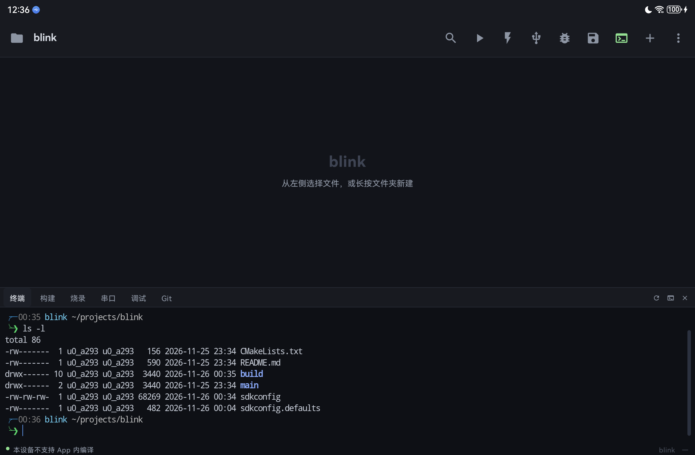
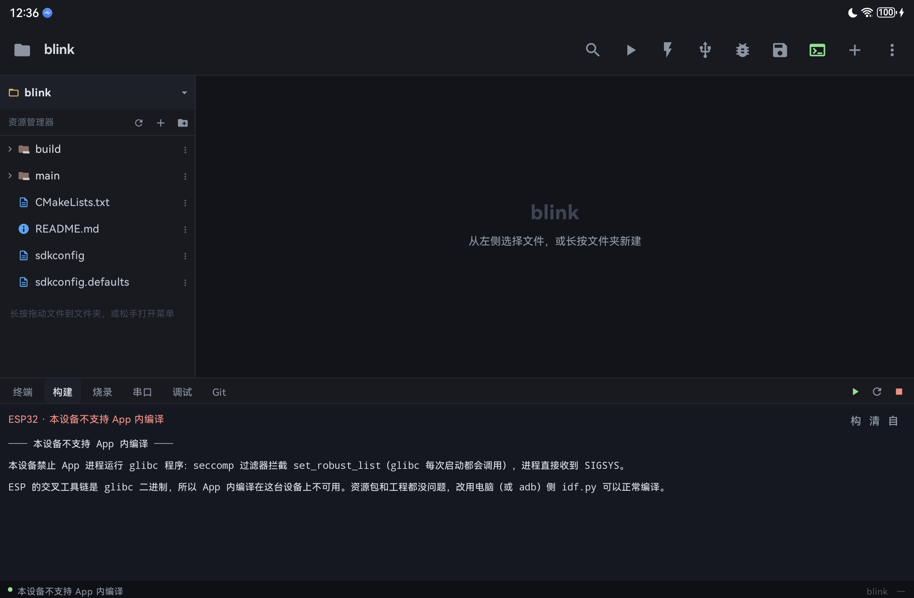

# EspForge — Android 平板上的 ESP32 IDE

> 官方 ESP-IDF 工程结构 + 平板本地编译 + USB 烧录 + 串口调试。
> 从 CodePad 派生；本文件同时是**交接文档**（换新会话时先读这里）。

- 工程目录：`D:\DSH\espstudio`
- 包名：`com.espforge.ide`　应用名：`EspForge`　版本：`0.1`
- 设备：HUAWEI BTK-W00（MatePad），Android 12，arm64-v8a，adb 序列号 `7VXYD24309200097`
- 最近更新：2026-11-26（落地 6 项修补、修好终端、查清 App 内编译的真实阻塞点）

---

## 一、现在能用的 / 不能用的

| 功能 | 状态 | 说明 |
|---|---|---|
| 编辑器 / 资源管理器 / Git / 搜索 | ✅ 可用 | Monaco，顶栏搜索框 + 浮层结果 |
| 工程生成 | ✅ 可用 | 官方 IDF 结构（`CMakeLists.txt` + `main/` + `sdkconfig.defaults`） |
| 资源包导入 + 自动修补 + `.ok` 标记 | ✅ **本次落地，真机验证** | 把 6 项修补写进了 `Toolchain`，见第四节 |
| 平板本地编译（CLI / `run-as`） | ✅ **干净构建通过** | 930/930、`blink.bin` 207,456 B、`blink.elf` 2,835,516 B |
| **App 内「构建」按钮** | ❌ **被系统禁止** | 设备 seccomp 杀 glibc 进程，见第六节（不是代码问题，也不是资源包问题） |
| 终端面板 | ✅ **已修** | 有提示符、能执行命令，见第五节 |
| 烧录 / 串口 | ⚠️ 代码已写，未真机验证 | `serial/EspFlasher.kt` 自己实现 esptool ROM 协议 |

### 已验证（真机）

用 `com.espforge.ide` 自己的 uid、App 自己修补过的资源包、`Toolchain.env()` 的同一套环境变量，
删掉 `build/` 和 `sdkconfig` 后完整跑了一遍官方流程（`run-as` 命令行）：

```
idf.py build  →  exit=0，[930/930]
blink.bin   207,456 字节
blink.elf 2,835,516 字节
```

结论：**资源包 + 6 项修补 + 环境变量是对的**，`idf.py build` 在这台平板上是能跑通的。
唯一跑不通的入口是「App 进程里直接 fork/exec 工具链」——原因见第六节。

---

## 二、工具链与构建环境

构建用的工具链不在仓库里，用 dsh-androidforge 插件自带的那套：

```powershell
$tc = 'D:\DSH\plugins\dsh-androidforge\toolchain'   # jdk17 / android-sdk / gradle-8.10.2
$env:JAVA_HOME="$tc\jdk17"; $env:ANDROID_HOME="$tc\android-sdk"; $env:ANDROID_SDK_ROOT=$env:ANDROID_HOME
$env:GRADLE_USER_HOME="$tc\gradle-home"; $env:ANDROID_USER_HOME="$tc\android-user"
$env:TEMP="$tc\tmp"; $env:TMP=$env:TEMP          # 必须，否则 gradle/adb 起不来
& "$tc\gradle-8.10.2\bin\gradle.bat" -p D:\DSH\espstudio assembleDebug --no-daemon --console=plain
```

产物：`app/build/outputs/apk/debug/app-debug.apk`（约 27 MB），另存 `dist\EspForge-0.1-arm64.apk`。

**adb 的坑**：adb 默认往 `%TEMP%\adb.log` 写日志，那个文件被沙箱 ACL 锁住会 `Permission denied`，
daemon 起不来。每次用 adb 前设 `$env:TEMP='D:\DSH\espstudio\.adbtmp'`。

### 原生库（`jniLibs`）要在仓库里编译，别用继承来的 .so

`app/src/main/jniLibs/arm64-v8a/libptybridge.so` 现在由 `native/ptybridge.c` 编译得到：

```powershell
$bin='D:\DSH\toolchain\ndk\android-ndk-r27c\toolchains\llvm\prebuilt\windows-x86_64\bin'
$env:TEMP='D:\DSH\espstudio\.ntmp'               # 同理，默认 TEMP 会被 ACL 挡住
& "$bin\aarch64-linux-android26-clang.cmd" -O2 -shared -fPIC `
    -o app\src\main\jniLibs\arm64-v8a\libptybridge.so native\ptybridge.c
```

**坑**：这个 .so 以前是从 CodePad 继承的，导出的是 `Java_com_codepad_ide_term_Pty_*`；
包名改成 `com.espforge.ide` 之后 JNI 符号找不到，`Pty.start()` 静默失败、终端全黑。
换包名/改包结构时，一定要同步重编原生库（`llvm-nm -D` 确认符号名）。

---

## 三、资源包（不进 APK）

`pack\esp-idf-5.2.5-arm64.zip`　**343.9 MiB**　sha256 `66a39432767dbc7131c81194d4f6871960dae392fef00f2166613398168a4f13`

```
esp-idf/                  ESP-IDF v5.2.5（裁掉 .git/docs/examples）
tools/xtensa-esp32-elf/   官方 per-chip 交叉工具链 12.2.0（原始二进制，未改）
tools/xtensa-esp32s3-elf/
tools/cmake/              bionic cmake 4.5 + ninja 1.13 + make，含 api-level.h
tools/python/             bionic python 3.14.10（Termux 构建）
tools/python-site/        esptool 4.14 / kconfiglib / pyyaml / pyelftools …
glibc/                    aarch64 glibc 运行时（Debian bookworm）
manifest.json
```

设备上的位置：`/data/user/0/com.espforge.ide/files/pack`（当前是 tar 侧载的 1.2 GB 解压版）。

重建脚本在 `pack/scripts/`：`build-pack-525.py`（可续跑）、`verify-pack-525.py`、`make-docs-525.py`。

### 关键设计：glibc 工具链怎么在 bionic 上跑

工具链是 glibc 二进制，Android 是 bionic，直接 exec 会找不到 `/lib/ld-linux-aarch64.so.1`。

- **不要**对工具链二进制做 `patchelf`（会破坏 ELF 段布局，`cc1` 段错误）
- 做法：`native/execshim.c`（NDK 编译，产物 `app/src/main/assets/execshim`）
  —— 一个原生 ELF 垫片，从 `/proc/self/exe` 向上找 `glibc/lib/ld-linux-aarch64.so.1` 定位 pack 根，
  然后 `execv(loader, [--library-path <glibc/lib> <自身>.real 原参数])`
- `Toolchain.wrapGlibc()` 把每个 ELF 可执行文件改名为 `*.real`，原位置放这个垫片
- **必须用 ELF 垫片，不能用 shell 脚本**：ninja 用 `posix_spawn` 直接 exec，脚本形式会 `code=127`

---

## 四、6 项资源包修补（已落地到代码）

以前这些修补只手工打在设备和 staging 上；现在全部写进了 `run/Toolchain.kt`，
在 `finalizePack()` 里幂等执行（解压后、以及每次启动发现包没就绪时）。

| # | 修补 | 实现 | 为什么 |
|---|---|---|---|
| 1 | `tools/cmake/bin/{ninja,cmake,make}` 里的 Termux shell 路径 → `/system/bin/sh`（**等长字节替换**，多余补 NUL） | `patchTermuxShell()` | Termux 版 ninja 把 shell 硬编码成 Termux 路径，每条命令 `code=127` |
| 2 | `tools/python-site/serial/tools/list_ports_posix.py` 给 Android 加分支返回 `[]` | `patchPyserial()` | 平台未知时 pyserial 直接 `raise ImportError`，esptool 一 import 就炸 |
| 3 | `site-packages/espforge_pack.pth` 写入 `$P/tools/python-site` | `patchPythonPath()` | `idf.py` 给子进程的环境会丢 `PYTHONPATH`，`.pth` 不依赖环境变量 |
| 4 | `esp-idf/tools/cmake/gdbinit.cmake` 在 `ESP_ROM_ELF_DIR` 为空时 `return()` | `patchGdbinit()` | 包里没有 rom-elfs，`file(TO_CMAKE_PATH)` 参数不足会中断 configure |
| 5 | 工程模板 `sdkconfig.defaults` 加 `CONFIG_MBEDTLS_CERTIFICATE_BUNDLE=n` | `fs/Templates.kt` | Termux 的 `cryptography` 缺 `_cffi_backend`，关掉证书包生成就够 |
| 6 | `env()` 不设 `IDF_PYTHON_ENV_PATH` | `Toolchain.env()` | 设了 IDF 会按 venv 校验依赖，走进 "venv doesn't exist" |

另外两件事也一并修了：

- **`.ok` 标记**：`isReady()` 依赖 pack 根的 `.ok-<PACK_VERSION>`（现在是 `.ok-2`）。
  以前 `wrapGlibc()` 只在「这次真的包了文件」时才写标记，tar 侧载的包永远拿不到 → App 一直说「没装资源包」。
  现在统一由 `markReadyIfComplete()` 在关键文件齐全时落标记，`PACK_VERSION` 变了老标记自动失效、重跑修补。
- **`refreshPack()` 的路径写错**：原来检查 `xtensa-esp-elf-gcc`（不存在的名字，实际是
  `xtensa-esp32-elf-gcc`），所以「包已解压但没整理」时自动整理的逻辑从来没触发过。
  现在改成 `finalizePack()`，构建前也会再兜一次。

验证方式（可复现）：把 zip 里的原始文件推回设备覆盖、删掉 `.ok*` 和 `.pth`，重启 App →
App 自己把 5 个文件改好、写出 `.pth`、落下 `.ok-2`，随后 CLI 构建通过。

---

## 五、终端（已修）

之前「xterm 起来了、光标在闪、但没有一个字节」，两处 bug：

1. **WebView 调用跑到 JavaBridge 线程**：`onTerminalReady()` 由 JS 桥在子线程回调，
   里面直接调 `applyTerminalSettings()` → `evaluateJavascript` → 抛
   "WebView method called on wrong thread"，整段中断，`ui { ensureTerminal() }` 从没执行。
   现在整个回调体都进 `ui {}`（主线程），并在主线程直接起 PTY。
2. **JNI 符号对不上**：`libptybridge.so` 还是 CodePad 的 `com.codepad.ide` 版本，
   `com.espforge.ide.term.Pty` 找不到 native 实现 → `Pty.start()` 失败（返回 false 且没有任何日志）。
   现在 `native/ptybridge.c` 在仓库里、符号是 `Java_com_espforge_ide_term_Pty_*`，
   失败时打 `Log.e` 并把原因写进终端。

终端里现在会先打一行 `[pty fd=… pid=…]`，方便确认 PTY 真的起来了。



---

## 六、⚠️ App 内编译的真实阻塞点：seccomp 杀 glibc 进程

这是**项目最关键的结论**，也是「App 里点 ▶ 构建不通」的真正原因（不是那 6 项修补）。

### 现象

cmake 的编译器测试失败，`[code=159]`，gcc 一句话都不说：

```
[1/2] .../xtensa-esp32-elf-gcc ... -o ... -c .../testCCompiler.c.obj
FAILED: [code=159] CMakeFiles/cmTC_b1abd.dir/testCCompiler.c.obj
```

在 App 内置终端里直接跑同一个 gcc，得到 `Bad system call`（= SIGSYS，退出码 159），
**连 `gcc --version` 都过不去**。

### 证据

| 检查 | 结果 |
|---|---|
| `adb shell cat /proc/<app pid>/status` → `Seccomp:` | `2`（装了 1 个过滤器） |
| `run-as com.espforge.ide sh -c 'cat /proc/self/status'` → `Seccomp:` | `0`（没有过滤器） |
| 在 App 终端里逐个数探测 syscall（`native/scprobe.c`） | `set_robust_list`、`get_robust_list`、`pkey_alloc`、`io_uring_setup`、`migrate_pages` → **signal=31 (SIGSYS)** |
| `signal(SIGSYS, SIG_IGN)` 后再 exec | 仍然 SIGSYS（说明是 `KILL_PROCESS`，不是可捕获的 TRAP） |

### 为什么必然失败

glibc 在 `__pthread_initialize_minimal_internal()` 里，**每个进程启动都会调 `set_robust_list`**。
设备的 app seccomp 过滤器把它判成必须处死，于是任何 glibc 二进制一 exec 就被 SIGSYS 杀掉。
ESP 的交叉工具链（`xtensa-esp32-elf-gcc`、`cc1`、`ld`…）全是 glibc 二进制 → 在 App 进程里一个都跑不起来。

**App 无法绕过**：seccomp 过滤器只能叠加、不能放宽（`unshare`/新 namespace 也不行）。
`run-as`/adb shell 之所以能跑，是因为那些进程不是 zygote 出来的，没有这个过滤器。

### 现在的表现

App 里点 ▶ 会先做一次 `gcc --version` 自检（`Toolchain.appProcessBlockedReason()`），
直接用中文说清楚原因，而不是甩一堆 cmake 报错。构建面板显示：

> 本设备禁止 App 进程运行 glibc 程序：seccomp 过滤器拦截 set_robust_list（glibc 每次启动都会调用），
> 进程直接收到 SIGSYS。ESP 的交叉工具链是 glibc 二进制，所以 App 内编译在这台设备上不可用。
> 资源包和工程都没问题，改用电脑（或 adb）侧 idf.py 可以正常编译。



### 可选的出路（需要产品决策）

1. **PC / 远程编译**：平板只做编辑 + 烧录 + 串口，编译交给同网段的 PC（或 aarch64 Linux 小主机）。
   现有 `idf.py` 产物格式（`build/flasher_args.json`）可以直接被 `EspFlasher` 消费，改动最小。
2. **换设备验证**：先在别的机型上确认是这台华为的策略问题还是 Android 12 通用。
   若别的机型允许 `set_robust_list`，App 内编译就能用，代码已经准备好了。
3. **root / 非 zygote 进程**：不可行（普通用户拿不到，且政策上不该走这条路）。
4. **bionic 版 xtensa 工具链**：理论上可行（把 GCC 交叉编译到 aarch64-linux-android），
   但工作量大、GCC host 需要完整 POSIX 环境，属于月级工程。

---

## 七、构建时正确的环境变量

与 `Toolchain.env(chip)` 一致（`run-as` 下照抄就能构建）：

```sh
P=<pack 根>                       # /data/user/0/com.espforge.ide/files/pack
APP=/data/user/0/com.espforge.ide
IDF_PATH=$P/esp-idf
IDF_TOOLS_PATH=$APP/files/idf-tools
PYTHONHOME=$P/tools/python        # Termux 前缀写死，必须覆盖
PYTHONPATH=$P/tools/python-site   # 配合第 3 项 .pth 更稳
PATH=$P/tools/python/bin:$P/tools/xtensa-esp32-elf/bin:$P/tools/cmake/bin:/system/bin
LD_LIBRARY_PATH=$P/tools/python/lib:$P/tools/cmake/lib     # 只给 bionic 程序；glibc 垫片里会 unset
HOME=$APP/files/home
TMPDIR=$APP/cache/tmp
IDF_COMPONENT_MANAGER=0
IDF_PYTHON_CHECK_CONSTRAINTS=no
ESPSTUDIO_SKIP_DEP_CHECK=1        # 对应 idf_tools.py 的补丁
IDF_TARGET=esp32
PREFIX=$P/tools/cmake             # Termux 版 cmake 靠它读 include/android/api-level.h
```

**不要设 `IDF_PYTHON_ENV_PATH`**。

---

## 八、UI 约定（别改坏）

- 键盘：`windowSoftInputMode=adjustNothing`（**代码里 `MainActivity.onCreate` 也有一行，改 manifest 不够**），
  内容列**不要**加 `imePadding()`。键盘直接盖住底部面板，不挤压编辑区。
- 底部 Dock **永远保持挂载**：不要按 `searchOpen`/键盘把高度收 0、更不要从组合里摘掉，
  否则终端 WebView 反复 attach，点「终端」标签直接崩。
- 终端 WebView 只在「终端」页挂载（其它页挂载会盖住构建/烧录面板，`AndroidView` 是原生层压不住）。
- 顶栏：图标统一灰色剪影，当前激活项变绿。搜索框是顶栏内联的 300dp 圆角长条（靠右贴图标），
  结果用 `Popup` 浮层（左对齐、零动画、14dp 圆角），不要用 `DropdownMenu`（有入场动画会瞬间盖住输入框）。

---

## 九、代码地图

```
app/src/main/java/com/espforge/ide/
├─ IdeController.kt   状态中枢：工程/文件/构建/串口/烧录/调试/Git
├─ Ui.kt              Compose 界面（顶栏、资源管理器、编辑器、底部 Dock：终端/构建/烧录/串口/调试/Git）
├─ MainActivity.kt    WebView 创建、资源包文件选择器、窗口软键盘策略
├─ run/
│   ├─ Toolchain.kt   资源包导入/整理/修补、glibc 垫片、IDF 环境变量、进程执行 ★
│   ├─ GdbClient.kt   GDB RSP 客户端（调试用，未接入）
│   └─ DwarfInfo.kt   DWARF 解析（未接入）
├─ serial/
│   ├─ UsbSerial.kt   UsbManager + usb-serial-for-android，DTR/RTS 复位时序
│   └─ EspFlasher.kt  esptool ROM loader 协议（SLIP / FLASH_BEGIN|DATA|END）
├─ fs/{Projects,Templates,Workspace,SearchService}.kt
└─ term/{Pty,TerminalSession}.kt
native/
├─ execshim.c         glibc 入口垫片（NDK: aarch64-linux-android26-clang -O2 -fPIE -pie）
├─ ptybridge.c        终端 PTY（forkpty + execve），产物进 jniLibs
└─ scprobe.c          seccomp 探测工具（诊断第六节的问题用）
pack/scripts/         资源包构建 + 各类补丁脚本
docs/DESIGN.md        设计说明（为什么不用 proot/patchelf/JTAG 等）
```

---

## 十、下一步

**先做产品决策**（第六节）：App 内编译被系统禁止，继续做「平板自己编译」还是转「PC 编译 + 平板烧录」。
在这之前，剩下能独立推进的事情：

1. 烧录：用 `build/flasher_args.json` + `EspFlasher` 真机烧一次（现在 `blink.bin` 已经有了），串口看日志
2. 串口面板：`createSerialWebView` 的 AssetLoader 已经补上（之前会白屏），真机确认能出日志
3. gdbstub 断点调试（复用 `GdbClient` + `DwarfInfo`）
4. 在另一台 Android 设备上复测第六节的结论（决定是不是这台华为的策略）
5. 资源包重新打包：把 6 项修补预先打进 zip（App 侧仍然会幂等检查，双保险）

---

## 十一、常用 adb 命令

```powershell
$env:TEMP='D:\DSH\espstudio\.adbtmp'; $env:TMP=$env:TEMP
$adb='D:\DSH\plugins\dsh-androidforge\toolchain\android-sdk\platform-tools\adb.exe'

& $adb devices
& $adb install -r app\build\outputs\apk\debug\app-debug.apk
& $adb shell am force-stop com.espforge.ide
& $adb shell am start -n com.espforge.ide/.MainActivity
& $adb shell "run-as com.espforge.ide sh -c 'ls files/pack'"        # 看 App 私有目录
& $adb logcat -d -s EspForge                                        # 只看自己的日志
& $adb shell screencap -p /sdcard/s.png; & $adb pull /sdcard/s.png $env:TEMP\s.png
& $adb shell input tap <x> <y>                                      # 屏幕实际 2200x1440
& $adb shell input text "ls%s-l"                                    # 空格要写 %s
```

坐标换算：截图预览宽 1596 → 实际 2200，比例 1.378。顶栏搜索图标实际位置约 `(1428, 121)`，
终端图标约 `(1973, 121)`，Dock 的「终端/构建」标签约 `(62, 933)` / `(178, 933)`，
构建面板的 ▶ 约 `(2068, 933)`。

---

## 十二、许可证与来源

GPL-3.0（沿用 CodePad）。ESP-IDF、GCC 工具链、CMake、Python 等第三方组件许可见
`THIRD_PARTY_NOTICES.md`。原始 CodePad 项目：https://github.com/Bro588/CodePad-Android
